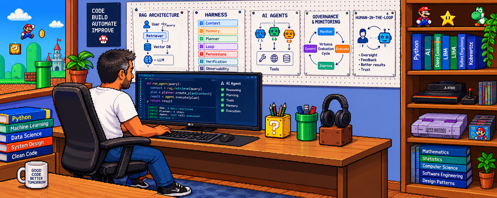

# Rodrigo Aguiar | Chemical Engineer · AI & Data Engineer

Chemical Engineer (UFPR) with an MSc in Chemical Engineering (UFSC) and 20+ years of experience spanning Industrial R&D, laboratory management, quality systems, and process improvement.

Currently expanding my work into **AI Engineering, Data Automation, and Systems Integration**, combining engineering fundamentals and operational experience with practical software development.

**Current Focus:** AI Agents · Workflow Automation · Data Pipelines · API Integration

**Availability:** GMT-3 (Brazil) · Flexible US time zone alignment

### Professional Background & Impact

- **Industrial R&D:** Experimental data analysis, applied research, laboratory systems, and process optimization.
- **Quality & Systems:** LIMS administration, ISO 17025-related environments, and engineering software integration.
- **Operational Efficiency:** Technical solutions delivering measurable productivity improvements and cost savings.
- **AI & Data Engineering:** Building automated workflows, integrating APIs, processing structured data, and exploring LLM-powered solutions.

### AI & Automation Engineering

From data ingestion to cloud storage, building practical, testable solutions with an emphasis on reliability, maintainability, and reproducibility.

**Areas of development:** Workflow orchestration, webhook integration, data ingestion and transformation, object storage, and LLM API integration.

### Cloud, Integration & Collaborative Development

Developing and testing end-to-end automation workflows using self-hosted n8n on Oracle Cloud Infrastructure (OCI), with Git and GitHub for version control and collaborative development.

Current hands-on work includes:
- API-based data collection and normalization.
- Webhook-driven ingestion and file processing.
- Integration with OCI Object Storage through an S3-compatible interface.
- Workflow documentation, testing, and structured pull-request reviews.

### LLMs & AI Ecosystem

Exploring LLM-powered automation, AI agents, retrieval-augmented generation (RAG), and model orchestration, with a focus on practical applications and measurable value.

### Connect

- 🧑‍💻 [LinkedIn](https://www.linkedin.com/in/rsouzaaguiar/?locale=en-US)
- 💼 [Professional Experience](https://raguiar.eng.br/profissao.html)
- 🌐 [Portfolio](https://raguiar.eng.br/en/index.html)
- 💬 [WhatsApp](https://wa.me/5547992704018?text=Hi%20Rodrigo.%20I%20checked%20your%20GitHub%20profile.)
- 📧 [Email](mailto:raguiar.eng@gmail.com?subject=GitHub%20contact)
